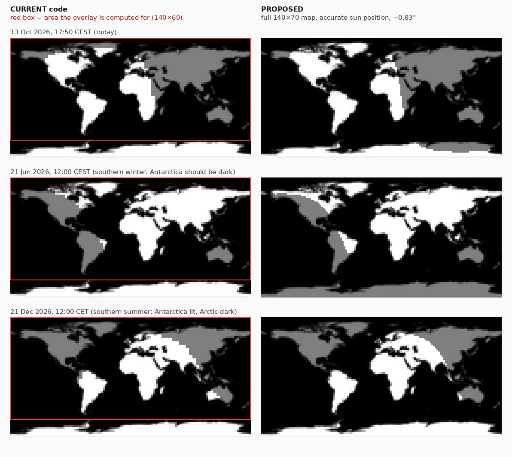

# Illuminator (Casio) watch face: technical review

*Review date: 13 Oct 2026. Working copy: `C:\Users\mirka\Vs-projects\Casio`, branch `main`, last commit "added 454 x 454 designs", plus untracked files.*

**How this review was done.** I read every source and resource file. To measure behavior instead of guessing, I ported the day/night code to Python and rebuilt the world map from its tile font, and I re-rendered the whole face from the font atlases to count lit pixels. Nothing was run in the Connect IQ simulator or on a watch. Any number about the device (lit pixels, memory, battery) is therefore an estimate. Appendix A explains how each number was produced.

---

## 0. Summary

| # | Finding | Severity | Effort |
|---|---------|----------|--------|
| 1 | **Antarctica is never shaded, in any season.** The night overlay covers a 140×60 area, but the map artwork is 140×70. The bottom 10 rows, which are Antarctica, are never covered. On 454×454 the overlay is 150×70 and the art is 160×80, so both the Antarctic rows and the last 10 columns stay white. The mismatch also squeezes the terminator vertically everywhere else on the map. | High (visible bug) | Two numbers in each `layout.xml` |
| 2 | **Always-on (AOD) mode is not implemented.** `is_lowpower` is set but never read, so the full face is redrawn every minute in AOD. About **19 % of the pixels are lit** (≈14 % weighted by brightness). Garmin's AOD budget on AMOLED is **10 %**. | High (battery, burn-in, the face may be blanked) | Medium |
| 3 | **The night overlay is the main CPU cost.** It draws ~1,150 (416 px) to ~1,440 (454 px) alpha rectangles per frame, which is about 90 % of all draw calls. It is rebuilt every minute with `Array.add()`, which reallocates and copies the whole array on every call: ~0.67 M to 1.0 M element copies per rebuild, ~1.7 M to 2.1 M allocations per day. | High (battery, prime crash suspect) | Medium |
| 4 | **The crash after a few days in AOD can't be proven from the code alone.** The top suspect is heap churn and fragmentation from #3. The crash log is needed to confirm (§3.7). | High | Steps in §3.7 |
| 5 | **The day/night math is approximate in other ways.** "Night" starts at sun elevation **+2.9°** (`0.05`), not the −6° the comment says. There is no equation of time (up to ±16 min). Declination can be off by up to 1.35°. | Medium | Small |
| 6 | **Several data fields are wrong in specific cases.** Humidity always shows `0`. Sunrise/sunset is 30 or 45 min off in half-hour time zones and shows `0-1:00` in polar regions. Location is only read at start-up or when settings change. Settings changes don't apply until the face restarts. One code path can crash on `null`. | Medium | Small |
| 7 | **There is waste on every frame.** Each field allocates a 14-entry Dictionary on every frame, `getDeviceSettings()` is called 7× per frame, a property is read every frame, and the same fonts are loaded 4×. | Medium (battery) | Small |
| 8 | **`resources-round-454x454` and `resources-round-390x390` are not tracked by git.** The last commit, "added 454 x 454 designs", does not contain the 454 folder, so the 454 design exists only on this laptop. | High (risk of losing the work) | 5 min |
| 9 | **Housekeeping is out of date.** `minApiLevel="1.2.0"` is wrong, there are unused permissions and properties and dead code, and the README is stale. | Low | Small |

> **About "Antarctica should be dark now":** on 13 October the **South Pole is in 24-hour daylight**. The solar declination is −7.9°. The pole's half year of night ran from about 23 March to 21 September 2026, and its sun now stays up until about **23 March 2027**. Today, everything south of ≈81° S is lit around the clock. The rest of Antarctica still has a dark period around local midnight, and that period shrinks every day until the Antarctic Circle reaches 24-hour daylight around 8 December. So after the fix you'll see the night side cover part of the Antarctic coast for part of the day. Antarctica goes dark through the southern winter and is fully dark around the June solstice. Right now it is the **Arctic** that is in its dark half of the year. The bug is still real: with the current code, Antarctica cannot be shaded in any season. The image below shows today, the June solstice and the December solstice.



---

## 1. Scope of the project

### 1.1 What it is
**Illuminator** is a Connect IQ **watch face** (`type="watchface"`, entry `IlluminatorApp`) styled after classic Casio digital watches. It is published on the Connect IQ store (see README) and the code is on GitHub (`Riso1989-git/illuminator`). It shows:

- a world map with a live day/night overlay (`WorldMap.mc`)
- an analogue clock built from pre-rendered tile fonts, with an optional second time zone (`Analogue.mc`)
- digital time HH:MM plus seconds (`TimeField.mc`) and the date `DDD dd-mm` (`DateField.mc`)
- steps and floors goal bars (`GoalMeter.mc`) and the move bar (`MoveBar.mc`)
- up to 6 configurable data fields in three zones (`DataFields.mc`): HR, battery, notifications, calories, distance, alarms, altitude, temperature, pressure, humidity, sunrise, sunset, weather temperature

### 1.2 Targets
`manifest.xml` lists **21 products, all of them AMOLED**:

| Resolution | Resource folder | Products |
|---|---|---|
| 416×416 | `resources-round-416x416` | venu2, venu2plus, epix2, epix2pro47mm, fenix843mm, fenixe, fr265, instinct3amoled50mm, d2airx10, d2mach1 |
| 454×454 | `resources-round-454x454` | venu3, epix2pro51mm, fenix847mm, fenix8pro47mm, fr965, fr970, fr57047mm |
| not mapped in `monkey.jungle` | resolved by folder name (`resources-round-WxH`) | approachs7047mm, d2mach2, descentmk351mm, venu445mm |
| 390×390 | `resources-round-390x390` | *(none; all 390 mappings in `monkey.jungle` are commented out)* |

Because every target is AMOLED, **always-on behavior and display power are the dominant battery topics** for this face, not partial updates. `onPartialUpdate` is not available on AMOLED.

### 1.3 Architecture

| File | Responsibility | Notes |
|---|---|---|
| `IlluminatorApp.mc` | AppBase, settings and location bootstrap, globals `gLocationLat/Lng` | Also loads field configs that nothing reads (§2.5) |
| `IlluminatorView.mc` | WatchFace view: `setLayout`, `onUpdate` → `View.onUpdate`, sleep hooks | `is_lowpower` is set and never used |
| `WorldMap.mc` | Draws 24 map tiles (28 on 454), then a 2×2-px night grid with alpha | §2.1 |
| `Analogue.mc` | Dial (25 tiles) and hands (3–7 tiles each) from tile fonts | Reads a property every frame |
| `TimeField.mc`, `DateField.mc` | Text with custom BMFonts | Seconds drawn every frame |
| `GoalMeter.mc`, `MoveBar.mc` | Outlined or filled segment bars | Cheap |
| `DataFields.mc` | Field values, icons, own sunrise/sunset algorithm | §2.4, §2.3 |
| `IlluminatorBackground.mc` | Drawable that clears the screen to **white** | Not used in any active layout |
| `resources-round-*/fonts/*` | Tile fonts made with *garmin-tilemapper* (`py` notes), plus JSON tile lists (`char \| x<<12 \| y<<22`) | Map art: 140×70 and 160×80 equirectangular |

### 1.4 Update model (what the system does)
- **High power** (for about 10 s after a wrist gesture): `onUpdate` runs **every second**, and every drawable redraws everything.
- **Low power / AOD** (the rest of the day, if AOD is enabled): `onUpdate` runs **once per minute**. On AMOLED, Garmin limits each update to **10 % of the display's pixels** and applies burn-in protection on some devices ([Garmin announcement](https://forums.garmin.com/developer/connect-iq/b/news-announcements/posts/changes-to-watch-face-low--and-high-power-modes)).
- There is no background service. The `Background` permission is declared but unused.

### 1.5 Settings
Field counts per zone (0–3, 0–2, 0–1), the field type for each slot, and the analogue clock's time zone. `properties.xml` also defines `BackgroundColor`, `ForegroundColor`, `UseMilitaryFormat` and `Field4`, which no setting and no code use.

### 1.6 Limits of this review
- I couldn't run the simulator or the watch, so I have **no crash log**, and the crash root cause in §2.2 is ranked by likelihood, not confirmed.
- I couldn't look up the exact memory limits of each target device here. Check them with the simulator's memory viewer.

---

## 2. Problems

### 2.1 World map and day/night

#### WM-1: Overlay and artwork sizes don't match. This is the Antarctica bug.
*Where:* `resources-round-416x416/layouts/layout.xml` lines 6–7 (`width 140`, `height 60`), `resources-round-454x454/layouts/layout.xml` (`width 150`, `height 70`), and `WorldMap.buildLookupTables()`.

I rebuilt the map from `worldMap.json` and the font atlas. The artwork is a **2:1 equirectangular map of 140×70 px** on 416 (and the identical 390 copy) and **160×80 px** on 454. Its feature positions match that projection: northern Greenland is at row ≈2.5 and the Antarctic coast at rows ≈60–62. The overlay, though, is computed for the size passed in the layout:

| | Artwork | Overlay grid | Never shaded | Distortion |
|---|---|---|---|---|
| 416 | 140×70 | 140×60 | rows 60–69, i.e. everything south of ≈−64° (Antarctica) | Overlay row *y* is treated as latitude `90 − 3y`, but the art has `90 − 2.57y`. Example: map row 50 is really −38.6° and the code treats it as −60°. |
| 454 | 160×80 | 150×70 | rows 70–79 (south of −67.5°) **and** columns 150–159 (157.5°E–180°: NZ, Fiji, Kamchatka) | Longitude error grows eastward up to **22.5°** (1.5 h of sun time), plus the same vertical squeeze |

In a Python port of the current code, the number of overlay cells on map rows ≥ 60 is **0 on every date**. The fix is in §3.1.

#### WM-2: The twilight threshold has the wrong sign
`TWILIGHT_THRESHOLD = 0.05` (line 21) means *night = sun elevation < asin(0.05) = **+2.87°***. The comment says civil twilight, which is −6°. As written, the night side is about 3° too large, roughly 1 px on this map.
- Night as sunrise/sunset: `sin(−0.833°) = −0.01454`. This is the standard value and includes refraction and the sun's radius.
- Civil twilight: `sin(−6°) = −0.1045`. A second, lighter band could use it if wanted.

#### WM-3: The sun position is approximated
- **Declination:** `0.4093·sin(2π(doy−80)/365)` ignores the eccentricity of Earth's orbit. Across 2026 its maximum error is **1.35°**, on 11 Oct, which is about 0.5 px vertically.
- **No equation of time.** The subsolar longitude assumes the sun crosses the meridian at exactly 12:00 UTC. The real offset ranges from −14.2 to +16.4 min, i.e. up to **4.1° or 1.6 px** horizontally. Today it is +13.8 min.
- `doy` comes from the local date while the hour is converted to UTC. That is harmless, but computing everything from `Time.now().value()`, which is already UTC, is simpler and has no time zone or DST edge cases.

These errors are small at this map size, but correcting them costs nothing (§3.2).

#### WM-4: Performance
| Metric | 416 (current) | 454 (current) | After a quick layout fix only | Proposed (§3.2) |
|---|---|---|---|---|
| Night cells drawn per frame (`fillRectangle` with alpha) | ~1,150 | ~1,440 | ~1,360 / ~1,780 | **9–86** merged rectangles (median 68 / 78) |
| Rebuild frequency | every minute | every minute | every minute | every 5 min, no allocation |
| `add()` element copies per rebuild (O(n²)) | ~0.67 M | ~1.03 M | ~0.93 M / ~1.59 M | 0 |

- Every `add()` creates a new array one element longer, copies the old one and frees it. During each step the array briefly uses about twice its size ([forum explanation](https://forums.garmin.com/developer/connect-iq/f/discussion/388311/array-data-size-limit/1847315)). At 1,440 rebuilds a day, that is ≈1.7–2.1 million allocations of growing size every day.
- The terminator moves only **1 px every ~10 min** on a 140-px map (9 min on 160 px), so recomputing every minute is 5–10× more work than needed.
- `GRID_STEP = 2` makes a 2-px stair-step edge. The proposed per-column method is both cheaper and more precise, at 1-px resolution.
- **Fixing only the layout makes the cost worse** (third column), so pair it with at least the minimal patch in §3.1.

#### WM-5: Minor
- The non-alpha fallback (`step = 2`, line 169) skips every other cell, which produces stripes. It is dead code on all current targets because they all support `setFill`.
- `Graphics.createColor(128,0,0,0)` is created every frame. Cache it.
- On 416, the top-right corner of the map (199 px, about 2 % of the map, the far-east Arctic) is outside the round screen.
- The git history ("removed positioning on map due to performance issues") shows a location marker was dropped because of cost. With §3.2 it costs one draw call.

### 2.2 Always-on display and the crash

#### AOD-1: There is no low-power rendering path
`IlluminatorView` sets `is_lowpower` in `onEnterSleep` and `onExitSleep` (lines 62 and 66), but nothing reads it. In AOD the face redraws everything once a minute: the white map, the dial, the large digits, all the bars and the fields.

Estimated lit pixels at 416×416, with sample values, at 17:50:

| Component | Share of display pixels lit |
|---|---|
| TimeField (HH:MM + seconds) | 6.0 % |
| GoalMeter (outlines, fills, icons) | 3.7 % |
| WorldMap (white land, grey night) | 3.6 % |
| DataFields (6 fields) | 2.6 % |
| Analogue (dial + hands) | 2.1 % |
| MoveBar | 0.9 % |
| DateField | 0.6 % |
| **Total** | **≈19.5 % of pixels non-black** (≈16.7 % brighter than 32/255; ≈14.3 % luminance-weighted) |

Garmin's rule for AMOLED AOD is that *"each update is limited to using 10% of the available pixels of the display"* ([announcement](https://forums.garmin.com/developer/connect-iq/b/news-announcements/posts/changes-to-watch-face-low--and-high-power-modes)). Developers report that a face over the limit simply goes black ([forum](https://forums.garmin.com/developer/connect-iq/f/discussion/322419/always-on-display-sleep-mode-behaviour-and-rules-on-newer-amoled-watches)). Older AMOLED devices also had a rule that no pixel may stay lit for 3 minutes ([forum](https://forums.garmin.com/developer/connect-iq/f/discussion/192673/how-to-enable-an-always-on-mode-for-venu-amoled/1255768)).

The consequences:
- **Battery:** AMOLED power scales with lit pixels × brightness × time, and AOD runs about 23 h a day.
- **Burn-in:** the map, dial and bar outlines sit at the same pixels around the clock.
- **Stale content:** the seconds show a value that is up to 59 s old, and the HR icon blinks on seconds that never update.

#### AOD-2: The crash after a few days in AOD
No deterministic exception path in the code explains *"crashes after a few days"*. A logic bug would usually crash within minutes or at a specific time. These are the ranked hypotheses:

| Rank | Hypothesis | For | Against | How to confirm |
|---|---|---|---|---|
| 1 | **Out of memory from heap churn.** The overlay is rebuilt every minute with `add()` (WM-4). Monkey C uses reference counting and, as far as I know, does not compact the heap, so millions of growing reallocations per day can fragment it until one allocation fails. | Fits "after days"; the workload is identical every minute whether in AOD or not; peak memory roughly doubles during each rebuild | Not proven without a log | Log type `Out Of Memory Error`, or `usedMemory` creeping up over hours (§3.7) |
| 2 | **Watchdog** (`Code Executed Too Long`) in the minute when the rebuild runs. That one `onUpdate` does 2,100–2,625 loop iterations, ~1,150–1,440 `add()` calls and ~1,150–1,440 alpha fills. | Heavy single frame | The watchdog counts instructions, so it would usually fire immediately, not after days | Log type `Watchdog Tripped Error` |
| 3 | **The system blanks the face because it breaks the 10 % AOD rule.** This may look like a crash. | The face is ≈2× over budget | It would happen from the first minute | Does the screen go black, or show the IQ error icon? |
| 4 | **Null access in `onSettingsChanged`.** `Activity.getActivityInfo()` can return `null` (line 124). This runs whenever settings sync from the phone. | A real latent bug | Not tied to AOD | Log stack points to `IlluminatorApp.onSettingsChanged` |

Fixes that remove all four suspects at once: §3.2 (no allocations, about 15× fewer draws), §3.4 (a real AOD path) and the null check in §3.6. Get the log first anyway, so you know which one it was.

### 2.3 Battery and CPU per frame (high-power mode)
At about 1,264 native draw calls per frame on 416, **the overlay is ≈90 %**. The rest:

| Where | Waste | Per frame |
|---|---|---|
| `DataFields.drawField` | New 14-entry `Dictionary` just to look up an icon | ×6 fields |
| `DataFields.getValue`, `TimeField.draw` | `Sys.getDeviceSettings()`, which builds a settings object | ×7 |
| `Analogue.applyTimezoneOffset` | `Properties.getValue("AnalogueTimezoneOffset")` | ×1 |
| `DataFields` temperature/pressure | Creates a `SensorHistory` iterator over the whole history (`null` options) to read one sample | per field |
| `DataFields` weather temperature | `Weather.getCurrentConditions()` | per field |
| `getTextDimensions` | Measured every frame for unchanged strings | ×7 |
| Fonts | `garmin_icons` and `text` each loaded **4×** (3× DataFields + GoalMeter, 3× DataFields + DateField) | at layout |

Most of these values change at most once a minute, or once an hour for weather. Only the seconds and the HR icon need per-second work (§3.5).

### 2.4 Data fields and time

- **DATA-1: Humidity always shows `0`.** The code calls `SensorHistory.getHumidityHistory`, guarded by `has`. The watches have no humidity sensor, and I don't know of any such SensorHistory function, so the check fails and the default `"0"` is shown. The README says the value comes from the Garmin weather service, which would be `Weather.getCurrentConditions().relativeHumidity`.
- **DATA-2: Sunrise/sunset is wrong in half-hour and 45-minute time zones.** Line 456 divides integers: `timeZoneOffset / 3600`. India (+5:30) is 30 min off and Nepal (+5:45) is 45 min off.
- **DATA-3: Polar regions show `0-1:00`.** `getSunTimes` returns `-1.0` for polar day or night (lines 443 and 447). `getSunEventTime` then formats it as `"0" + (-1) + ":00"`.
- **DATA-4: Location is rarely updated.** It is read only in `onSettingsChanged`, which runs at start-up and when settings change, and only from `Activity.getActivityInfo().currentLocation`, which is usually `null` on a watch face. After travel, the sunrise/sunset location stays wrong until the face restarts. On a fresh install the field may keep showing `gps?` until the face restarts at a moment when a location is available. The sun-time cache is keyed only by day, so a new location wouldn't invalidate it either.
- **DATA-5: Possible null crash.** `Activity.getActivityInfo().currentLocation` has no null check on `getActivityInfo()` (line 124).
- **DATA-6: Settings changes don't apply live.** `DataFields.loadSettings()` runs only in `initialize`, and the call that would propagate changes from `IlluminatorApp.onSettingsChanged` is commented out (line 149). Meanwhile `IlluminatorApp.loadFields`, `hasField` and `get*Fields` build the same lists and nothing reads them.
- **DATA-7: Altitude ignores the user's units.** It is always in metres, even when `DeviceSettings.elevationUnits` is statute.
- **DATA-8: The second time zone list is incomplete.** It is missing +3:30, +4:30, +5:45, +6:30, +8:45, +10:30, +12:45, +13, +14, −3:30 and −9:30. Fixed offsets also don't follow DST, which the "Standard" labels acknowledge. UTC is encoded as the magic value `1`.
- **DATA-9: Minor.** 12-hour mode has no AM/PM marker, and `UseMilitaryFormat` is defined but unused. Day names are hard-coded in English.

### 2.5 Project and build housekeeping
- **HYG-1: Untracked design work.** `resources-round-454x454/` and `resources-round-390x390/` are untracked (the git index holds 51 files, all of them 416 or common). There is no `.gitignore`, so `bin/` shows up as noise.
- **HYG-2: Wrong minimum API.** `minApiLevel="1.2.0"`, while the code needs at least 3.2 for `Toybox.Weather` and uses `setFill`/alpha where it exists. The README repeats "SDK 1.2.0".
- **HYG-3: Unused permissions.** No code uses `Ant`, `Background`, `ComplicationSubscriber`, `PushNotification` or `UserProfile`. Users see these at install. Keep `Positioning` only if §3.6 (Position or Weather location) is adopted.
- **HYG-4: Dead code and resources.**
  - `IlluminatorBackground` clears to **white** and is unused.
  - `resources/layouts/layout.xml` references a non-existent class `Background`.
  - `IlluminatorApp.loadFields`, `hasField` and `get*Fields` are unused, as are the colour strings and properties.
  - The 390 folder serves no product.
  - `worldMap`/`worldMapJson` are defined twice in each round folder (`resources.xml` and `fonts/resources.xml`).
  - `source/crystal-face.code-workspace` points to folders outside the repo.
- **HYG-5: Four products aren't in `monkey.jungle`.** approachs7047mm, d2mach2, descentmk351mm and venu445mm rely on the automatic `resources-round-WxH` qualifier. Check each of them in the simulator.
- **HYG-6: The README is out of date.** It says "Venu 2 (primary target), 416x416", calls `Background` "background processing support", and gives the wrong humidity source.

---

## 3. Proposed solutions

### 3.1 WorldMap quick fix
1. Make the layout match the artwork:
   ```xml
   <!-- resources-round-416x416/layouts/layout.xml (and 390) -->
   <param name="width">140</param>
   <param name="height">70</param>
   <!-- resources-round-454x454/layouts/layout.xml -->
   <param name="width">160</param>
   <param name="height">80</param>
   ```
   *Better:* derive the size from the tile data so it can't drift again. Read the largest tile x and y from `worldMapJson`, or store `[w, h]` as an extra element in the JSON when generating it.
2. Stop the `add()` churn. Preallocate once and keep a count:
   ```monkeyc
   // buildLookupTables():
   mNightOverlayPoints = new [mGridXCount * mGridYCount];
   mNightCount = 0;

   // calculateNightOverlayOptimized(): replace `mNightOverlayPoints = [];` and `.add(...)`
   mNightCount = 0;
   ...
   mNightOverlayPoints[mNightCount] = (x << 16) | y;
   mNightCount++;

   // drawDayNight(): iterate i < mNightCount
   ```
3. Recompute every 5 minutes instead of every minute, and fix the threshold to `-0.01454`.

These three changes fix Antarctica, remove the per-minute allocation storm and are low-risk. The per-frame draw count stays high, though (§3.2 fixes that).

### 3.2 WorldMap recommended rewrite: one night span per column
For a fixed longitude, sun elevation as a function of latitude is `a·sin φ + b·cos φ = R·sin(φ + ψ)`. For any threshold ≤ 0 the night set is **exactly one contiguous interval per column**, with closed-form edges. I checked this against brute-force per-pixel evaluation over all of 2026 at 37-minute steps for −0.833° and −6°: **278 million pixels, 0 mismatches**. The cost:
- recompute: 140–160 iterations of a few trig calls, every 5 min, **no allocation**
- draw: one rectangle per run of equal columns, **9–86 per frame** instead of 1,150–1,780

*Sketch: not compiled; adapt names and types to your style.*

```monkeyc
import Toybox.Graphics;
import Toybox.Lang;
import Toybox.Math;
import Toybox.Time;
import Toybox.WatchUi;

class WorldMap extends WatchUi.Drawable {

    private const NIGHT_SIN_ALT = -0.01454;   // sin(-0.833 deg): sunrise/sunset
    private const RECALC_SECONDS = 300;       // terminator moves ~1 px / 10 min

    private var mX as Number;
    private var mY as Number;
    private var mW as Number;                 // must equal the artwork: 140x70 / 160x80
    private var mH as Number;
    private var mFont;
    private var mTiles as Array<Number>;
    private var mSpans as Array<Number>;      // per column: (top << 8) | bottom, -1 = all day
    private var mLastCalc as Number = 0;
    private var mNightFill;

    function initialize(params as Dictionary) {
        Drawable.initialize({ :identifier => "WorldMap" });
        mX = params[:positionX];
        mY = params[:positionY];
        mW = params[:width];
        mH = params[:height];
        mFont = WatchUi.loadResource(Rez.Fonts.worldMap);
        mTiles = (WatchUi.loadResource(Rez.JsonData.worldMapJson) as Array<Array<Number>>)[0];
        mSpans = new Array<Number>[mW];
        mNightFill = Graphics.createColor(128, 0, 0, 0);
    }

    function draw(dc as Graphics.Dc) as Void {
        var now = Time.now().value();                       // UTC seconds
        if (now - mLastCalc >= RECALC_SECONDS || now < mLastCalc) {
            mLastCalc = now;
            computeSpans(now);
        }

        dc.setColor(Graphics.COLOR_WHITE, Graphics.COLOR_TRANSPARENT);
        for (var i = 0; i < mTiles.size(); i++) {
            var p = mTiles[i];
            dc.drawText(mX + ((p >> 12) & 0x3FF), mY + ((p >> 22) & 0x3FF),
                        mFont, (p & 0xFFF).toChar(), Graphics.TEXT_JUSTIFY_LEFT);
        }

        dc.setFill(mNightFill);
        var x = 0;
        while (x < mW) {                                    // merge equal neighbouring columns
            var s = mSpans[x];
            var x2 = x + 1;
            while (x2 < mW && mSpans[x2] == s) { x2++; }
            if (s >= 0) {
                var top = s >> 8;
                dc.fillRectangle(mX + x, mY + top, x2 - x, (s & 0xFF) - top + 1);
            }
            x = x2;
        }
    }

    // Sun position: USNO "approximate solar coordinates", ~0.01 deg in this century.
    private function computeSpans(t as Number) as Void {
        var d = t / 86400.0d - 10957.5d;                    // days since J2000.0
        var g = Math.toRadians(wrap360(357.529d + 0.98560028d * d));
        var q = wrap360(280.459d + 0.98564736d * d);
        var lam = Math.toRadians(q + 1.915d * Math.sin(g) + 0.020d * Math.sin(2 * g));
        var eps = Math.toRadians(23.439d - 0.00000036d * d);
        var ra = Math.toDegrees(Math.atan2(Math.cos(eps) * Math.sin(lam), Math.cos(lam)));
        var decl = Math.asin(Math.sin(eps) * Math.sin(lam));
        var eotMin = 4.0d * (wrap360(q - ra + 180.0d) - 180.0d);   // equation of time
        var subLon = -15.0d * ((t % 86400) / 3600.0d - 12.0d + eotMin / 60.0d);

        var a = Math.sin(decl);
        var cd = Math.cos(decl);
        var halfPi = Math.PI / 2;
        for (var x = 0; x < mW; x++) {
            mSpans[x] = -1;
            var lon = (x + 0.5d) * 360.0d / mW - 180.0d;
            var b = cd * Math.cos(Math.toRadians(lon - subLon));
            var r = Math.sqrt(a * a + b * b);
            if (r < 0.000001d || NIGHT_SIN_ALT / r <= -1.0d) { continue; }   // no night here
            var half = halfPi + Math.asin(NIGHT_SIN_ALT / r);
            var c = wrapPi(3 * halfPi - Math.atan2(b, a));   // latitude of the darkest point
            var latLo = c - half;
            var latHi = c + half;
            if (latLo < -halfPi) { latLo = -halfPi; }
            if (latHi > halfPi) { latHi = halfPi; }
            if (latLo >= latHi) { continue; }
            var y0 = Math.ceil((halfPi - latHi) / Math.PI * mH - 0.5d).toNumber();
            var y1 = Math.floor((halfPi - latLo) / Math.PI * mH - 0.5d).toNumber();
            if (y0 < 0) { y0 = 0; }
            if (y1 > mH - 1) { y1 = mH - 1; }
            if (y0 <= y1) { mSpans[x] = (y0 << 8) | y1; }
        }
    }

    private function wrap360(v) { return v - 360.0d * Math.floor(v / 360.0d); }
    private function wrapPi(v) {                               // -> [-PI, PI)
        var twoPi = 2 * Math.PI;
        return v - twoPi * Math.floor((v + Math.PI) / twoPi);
    }
}
```

Options that become cheap with this approach:
- **Civil twilight band:** run `computeSpans` a second time with `sin(−6°)` into a second array and draw it with a lighter alpha (for example 64).
- **"You are here" marker:** one `fillCircle` at `((lon+180)/360·W, (90−lat)/180·H)`.

### 3.3 Optional: cache the composed map in a BufferedBitmap
The map only changes every 5 minutes, but it is redrawn every second in high power. On Connect IQ 4+ devices, which should cover all the targets (confirm in the SDK device list), `Graphics.createBufferedBitmap({:width=>W, :height=>H})` allocates from the graphics pool rather than the app heap. Draw the tiles and spans into its `Dc` once per recompute. Each frame then becomes a single `dc.drawBitmap(mX, mY, bufferRef)`. Check in the simulator that alpha fills work inside a buffered bitmap on your devices, and how much memory it uses. Expect tens of KB for 140×70 at full colour depth.

### 3.4 A proper always-on mode
Goal: **well under 10 % of pixels lit**. Aim for about 6–8 % so there is headroom, and add burn-in shifting.

```monkeyc
// IlluminatorView
private var mLowPower as Boolean = false;
private var mBurnIn as Boolean = false;

function onLayout(dc as Dc) as Void {
    var ds = System.getDeviceSettings();
    mBurnIn = (ds has :requiresBurnInProtection) && ds.requiresBurnInProtection;   // true on AMOLED
    setLayout(Rez.Layouts.WatchFace(dc));
    // ... findDrawableById as today
}

function onUpdate(dc as Dc) as Void {
    dc.setColor(Graphics.COLOR_TRANSPARENT, Graphics.COLOR_BLACK);
    dc.clear();
    if (mLowPower && mBurnIn) {
        drawAlwaysOn(dc);          // time (+ date), dimmed, shifted; no map, bars, fields, seconds
        return;
    }
    View.onUpdate(dc);
}

// TIME_X / TIME_Y: the TimeField position from layout.xml; mBigFont: Rez.Fonts.text_big, loaded once
private function drawAlwaysOn(dc as Dc) as Void {
    var t = System.getClockTime();
    var dx = (t.min % 7) - 3;              // wander +-3 px so no pixel stays lit
    var dy = ((t.min / 7) % 7) - 3;
    var h = t.hour;
    if (!System.getDeviceSettings().is24Hour) { h = (h % 12 == 0) ? 12 : h % 12; }
    dc.setColor(Graphics.COLOR_LT_GRAY, Graphics.COLOR_TRANSPARENT);
    dc.drawText(TIME_X + dx, TIME_Y + dy, mBigFont, h.format("%02d") + ":" + t.min.format("%02d"),
                Graphics.TEXT_JUSTIFY_LEFT);
    // optional: date in DK_GRAY, or analogue hands only (no dial) ~ +1 %
}

function onEnterSleep() as Void { mLowPower = true;  WatchUi.requestUpdate(); }
function onExitSleep()  as Void { mLowPower = false; WatchUi.requestUpdate(); }
```

From the breakdown in §2.2, time without seconds plus date is roughly **5.5–6.5 %**, lower once dimmed to light grey. Adding the map (+3.6 %) or the goal bars (+3.7 %) would break the budget. If you want the map in AOD, draw a dim version: land in `COLOR_DK_GRAY`, night land not drawn. Measure it with the simulator's screen heat map in low-power mode; it flags pixels over the limit ([forum](https://forums.garmin.com/developer/connect-iq/f/discussion/287537/amoled-high-to-low-power-mode-transition-in-sim-triggers-burn-in/1386870)).

### 3.5 Frame budget: per second vs per minute
Split work by how often it really changes:

| Cadence | Work |
|---|---|
| Per settings change | `loadSettings()`, analogue time zone offset, `is24Hour`, units |
| Per 5 min | Day/night spans (map bitmap if §3.3) |
| Per minute | Field strings, date string, HH:MM string and its width, ActivityMonitor values, goal and move bars |
| Per hour (or on change) | Location, sunrise/sunset, weather |
| Per second (high power only) | Seconds, HR value and blinking icon |

```monkeyc
// DataFields: compute strings once per minute, draw cached strings every frame
private var mCachedMinute as Number = -1;
private var mValues as Array<String> = [];

function draw(dc as Graphics.Dc) as Void {
    var m = System.getClockTime().min;
    if (m != mCachedMinute) { mCachedMinute = m; refreshValues(); }   // one getDeviceSettings() here
    // ... draw mValues; refresh only the HR slot every second
}

// replace the per-call Dictionary
private const ICONS = ["i", "Q", "H", "U", "{", "O", "Æ", "W", "o", "M", "n", "_", null, "W"];
var icon = (fieldType >= 0 && fieldType < ICONS.size()) ? ICONS[fieldType] : null;
```
Load `text`, `garmin_icons` and the other fonts **once**, in the view or a small global cache, and pass them to the drawables.

### 3.6 Data field fixes
- **Sunrise/sunset:** use the system's own calculation, `Weather.getSunrise(location, Time.now())` and `Weather.getSunset(...)`. They return a `Time.Moment`, or `null` when there is no event. Check for `null`, which covers polar day and night, and show `--:--`. Format with `Gregorian.info(moment, Time.FORMAT_SHORT)`, which handles DST and :30/:45 zones. If you keep the own algorithm, use `timeZoneOffset / 3600.0` and handle the `-1.0` sentinel.
- **Location:** check about once an hour, in order: `Weather.getCurrentConditions().observationLocationPosition`, then `Activity.getActivityInfo()` (null-checked) `.currentLocation`, then the stored value. Invalidate the sun-time cache when the location changes.
- **Humidity:** `Weather.getCurrentConditions().relativeHumidity`.
- **Temperature and pressure:** `SensorHistory.getTemperatureHistory({:period => 1})`, refreshed once a minute.
- **Altitude:** convert to feet when `elevationUnits == System.UNIT_STATUTE`.
- **Null-safe start-up:**
  ```monkeyc
  var info = Activity.getActivityInfo();
  var location = (info != null) ? info.currentLocation : null;
  ```
- **Live settings:** in `IlluminatorApp.onSettingsChanged()`, call a view method that runs `loadSettings()` on the three `DataFields`, clears the caches and calls `requestUpdate()`. Delete the duplicate field loading in `IlluminatorApp`.
- **Second time zone:** either a numeric "UTC offset in minutes" setting, or complete the list. Encode UTC as `0` offset with a separate "local" option rather than the magic `1`.
- **Alternative:** subscribe to system **complications** (Connect IQ 4.2+, and `ComplicationSubscriber` is already declared) for sunrise, sunset, weather and similar. The system then does the location and weather work. Worth it if you want to drop your own sun and location code.

### 3.7 Diagnosing the crash
1. **Store build:** open the **ERA** (Exception Reporting App) viewer that comes with the Connect IQ SDK and select Illuminator. It lists crash reports uploaded from users' watches, with the error type and stack.
2. **Sideloaded build:** connect the watch over USB and look in `GARMIN\APPS\LOGS\` for `CIQ_LOG.YML`. It may already be renamed to `.BAK` after a sync uploaded it ([forum](https://forums.garmin.com/developer/connect-iq/f/discussion/230779/what-happened-to-error-logging/1096363)). To capture `System.println`, create an empty `<PRG name>.TXT` in the same folder.
3. **Temporary instrumentation:** once an hour, `System.println` the `System.getSystemStats().usedMemory` and `freeMemory`. A rising floor confirms hypothesis 1.
4. **Simulator:** use the memory viewer for peak memory, enable low-power or always-on mode plus the screen heat map, and use time simulation to fast-forward days. Menu names differ between SDK versions.

### 3.8 Housekeeping
- `git add resources-round-454x454 resources-round-390x390` and commit. Add a `.gitignore` containing `bin/` and `*.der`, if a signing key ever lands in the folder.
- Raise the minimum API level in the manifest to what the code needs (≥ 3.2 for Weather; ≥ 4.x if you adopt BufferedBitmap from the graphics pool) and fix the README.
- Remove the unused permissions, properties, strings, the `IlluminatorBackground` drawable, the default layout's `Background`, and the duplicate `worldMap` resource definitions.

---

## 4. Suggested order of work
| Priority | Item | Why | Rough effort |
|---|---|---|---|
| P0 | Commit the 454 and 390 folders, add `.gitignore` | Avoid losing work | 5 min |
| P0 | Get the crash log (ERA or `CIQ_LOG.YML`) | Confirm the root cause | 15 min |
| P1 | §3.1 quick fix (layout size, preallocated array, 5-min recompute, threshold) | Fixes Antarctica, removes allocation churn | 30 min |
| P1 | §3.4 AOD path | Biggest battery gain, AOD compliance, burn-in | 2–3 h |
| P2 | §3.2 rewrite (closed-form spans, accurate sun) | About 15× fewer draws, more accurate | 2–3 h |
| P2 | §3.5 caching, shared fonts, null check | CPU and battery, robustness | 2 h |
| P3 | §3.6 data fixes (humidity, sun times, location, units, live settings) | Correctness | 2 h |
| P3 | §3.3 buffered map | Further CPU saving in high power | 1–2 h |
| P4 | §3.8 housekeeping | Maintainability, user trust | 1 h |

---

## 5. Test plan
**Day/night**
- Set the simulator time to these dates and compare with a reference day/night map such as timeanddate.com:
  - **21 Jun, 12:00 UTC:** Antarctica fully dark, Arctic fully lit.
  - **21 Dec:** the opposite.
  - **20 Mar / 23 Sep:** a nearly vertical terminator with both poles on the edge.
  - **Today:** only part of the Antarctic coast in shade (see the image).
- Check that nothing jumps across 00:00 UTC, a local midnight, or the **EU DST change on 25 Oct 2026**.
- On 454: Fiji and NZ (the last 10 columns) are shaded at their local night.

**AOD**
- Simulator low power plus heat map: under 10 % lit, no red (stuck) pixels.
- On the watch: AOD shows the dimmed face, not a black screen.

**Stability**
- Peak memory before and after §3.1/§3.2.
- 72 h of simulated low-power time with no crash.
- On the device, the hourly `usedMemory` log stays flat.

**Battery**
- 24 h AOD drain before and after, at the same brightness and settings, compared with a stock Garmin face as a baseline.

**Data**
- Sunrise/sunset for Mumbai (+5:30), Kathmandu (+5:45) and Longyearbyen (polar night and day).
- Humidity shows a real value.
- Changing a field in Garmin Connect updates the face without a restart.

---

## 6. Open questions
1. **What exactly happens at the "crash"?** Does the face switch to a default face, show the IQ error icon, go black, or does the watch reboot? On which watch model and firmware? Store build or sideloaded?
it was user message and he only mention that it crashed on allways on display settings, nothing to fix if we dont know details.
2. **What should AOD show?** Time only, time + date, or also the analogue hands or a dimmed map? Is it acceptable to drop the map, bars and fields in AOD?
on this watch, we should show time +date + analougue hands and dimmed map, nothing else
3. **Night style:** a hard edge at sunrise/sunset, or extra twilight bands (civil, nautical, astronomical)? How dark should night be on AMOLED? It is 50 % grey now.
we should keep 50% grey as now, if possible we can use extra twilight bands (civil) but if that would not work as should keep hard edges
4. **Location marker:** should "you are here" come back on the map now that it is cheap?
no this was for debug only
5. **Seconds:** keep them? In high power they force a full redraw every second. A setting could hide them.
setting should hide them.
6. **Minimum firmware:** is it fine to require Connect IQ 4.x on every target? That is needed for the graphics-pool bitmap in §3.3.
yes
7. **Data sources:** compute sunrise/sunset and location yourself, or switch to system complications or `Weather.getSunrise`? Keep the wrist "Thermometer" field? It reads mostly skin temperature while worn.
remove thermometer, compute sunrise/sunset ourselves
8. **Second time zone:** a free UTC offset in minutes, or a fixed list? Should DST be handled?
DST should not be handled, second time zone works fine (it should show just time on analogue)
9. **Leftover settings:** are `BackgroundColor`, `ForegroundColor` and `UseMilitaryFormat` planned features or leftovers from the Crystal face base?
remove them
10. **390×390:** support those devices (Venu 3S, FR165, etc.), or delete the folder?
we should support them
11. **Store version:** is the published version built from this exact working copy? ERA data only makes sense against the matching build.
current build is from this version
---

## Appendix A: How the numbers were obtained
- **Map artwork size:** I reassembled the tiles from `worldMap.json`, `.fnt` and `.png` (packing `char | x<<12 | y<<22`). The non-black content spans x 0–139 / y 2–69 on 416 and x 0–159 / y 3–79 on 454. Coastlines such as Greenland, the southern tips of Africa and South America, and Antarctica fall where a 2:1 equirectangular projection puts them.
- **Current overlay:** a line-by-line Python port of `calculateNightOverlayOptimized()`, evaluated across 2026 to count night cells, plus the `add()` copy cost `n(n+1)/2`.
- **Proposed algorithm:** the closed form was compared with a brute-force per-pixel evaluation over 2026 at 37-min steps for −0.833° and −6°: 278,437,600 pixel checks, 0 mismatches, never more than one night interval per column. The sun position matches a reference implementation (decl −7.94°, subsolar longitude −60.95° at 15:50 UTC today).
- **Lit pixels:** I re-rendered the 416 face from the actual font atlases at the layout positions with sample values (17:50:30, HR 72, 5.2 km, 14°, 07:21/18:17, 85 %, steps 60 %, floors 30 %, move level 2). Glyph alpha was approximated from atlas luminance, and only pixels inside the 416-px circle were counted. Treat the result as ±2–3 percentage points.
- **Decl/EoT error:** the code's sinusoid was compared with the USNO approximate solar coordinates for every day of 2026.

## Appendix B: Sources
- [Garmin: Watch Face Low- and High-Power Modes (Connect IQ news)](https://forums.garmin.com/developer/connect-iq/b/news-announcements/posts/changes-to-watch-face-low--and-high-power-modes)
- [Forum: Always-on behaviour and rules on newer AMOLED watches](https://forums.garmin.com/developer/connect-iq/f/discussion/322419/always-on-display-sleep-mode-behaviour-and-rules-on-newer-amoled-watches)
- [Forum: How to enable an always-on mode for Venu/AMOLED (CIQ 3.1 rules)](https://forums.garmin.com/developer/connect-iq/f/discussion/192673/how-to-enable-an-always-on-mode-for-venu-amoled/1255768)
- [Forum: Is there an always-on display basic example anywhere?](https://forums.garmin.com/developer/connect-iq/f/discussion/398404/is-there-an-always-on-display-basic-example-anywhere/1874010)
- [Forum: AMOLED high→low power transition, heat map, `requiresBurnInProtection`](https://forums.garmin.com/developer/connect-iq/f/discussion/287537/amoled-high-to-low-power-mode-transition-in-sim-triggers-burn-in/1386870)
- [Forum: Array data size limit (`add()` reallocates and copies)](https://forums.garmin.com/developer/connect-iq/f/discussion/388311/array-data-size-limit/1847315)
- [Forum: What happened to error logging? (`CIQ_LOG.YML`, ERA)](https://forums.garmin.com/developer/connect-iq/f/discussion/230779/what-happened-to-error-logging/1096363)
- [USNO: Approximate Solar Coordinates](https://aa.usno.navy.mil/faq/sun_approx)
